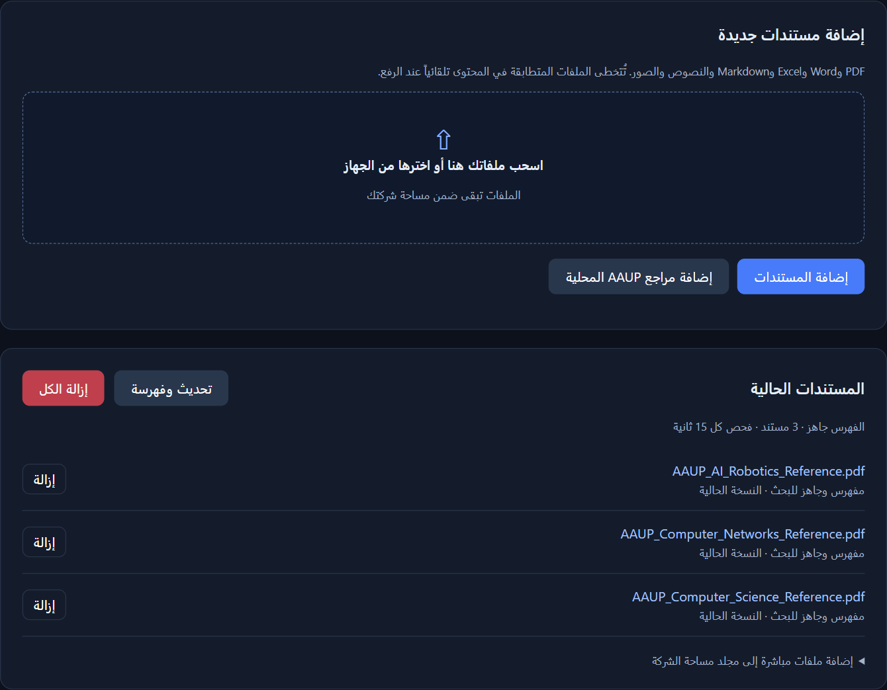
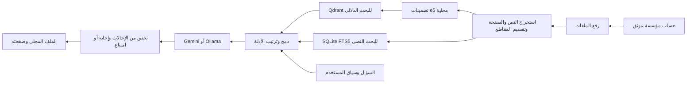

# CampusIQ - توثيق المشروع ومراجع العرض

تاريخ المراجعة: **7 نوفمبر 2026**. العرض ونسخة PDF في [مجلد العرض](./presentation/)، ودليل التجربة في [حزمة المقيّمين](../reviewer_pack/README.md).

## الفكرة والمشكلة

CampusIQ مساعد عربي/إنجليزي يجيب من مستندات المؤسسة، مع إحالة قابلة للفتح إلى الملف المحلي وصفحته. بدأت حالة التطبيق بالقبول والتسجيل وخطط AAUP، ويدعم المنتج ملفات مؤسسات أخرى ضمن حسابات مستقلة.

المشكلة التي نستهدفها هي الوصول إلى معلومة موثوقة موزعة بين لوائح وخطط وجداول، وفهم سؤال الطالب اليومي وربط القواعد اللازمة. **لا نملك بعد استبياناً محلياً أو قياساً موثقاً لوقت البحث أو نسبة الأسئلة المكررة أو استعداد المؤسسات للدفع.** لا يُعرض أي منها كحقيقة في العرض.

للدليل الخارجي، اختبرت دراسة Page وGehlbach مساعداً للمساعدة قبل الالتحاق في جامعة Georgia State. ارتفع الالتحاق في خريف 2016 بمقدار **3.3 نقطة مئوية** لدى الطلاب الذين أبدوا التزاماً بالجامعة في مجموعة المعالجة مقارنةً بالضبط. هذه نتيجة تلك الدراسة، وليست نتيجة CampusIQ أو دراسة لفلسطين. المصدر: [البحث الأصلي، DOI](https://doi.org/10.1177/2332858417749220).

## نطاق السوق الموثق

المرجع هو [وزارة التربية والتعليم العالي، الكتاب الإحصائي 2024/2025](https://www.mohe.pna.ps/LinkClick.aspx?fileticket=aZpJ4JTdBW8%3d&tabid=138&portalid=0&mid=924)، من [بوابة الإحصاءات الرسمية](https://www.mohe.pna.ps/services/statistics).

| المؤشر | القيمة | النطاق والتفسير |
| --- | ---: | --- |
| الطلبة المسجلون | 134,969 | المحافظات الشمالية، 2024/2025، النص العربي في صفحة PDF 13. |
| طلبة الجامعات | 125,827 | الملخص العربي، صفحات PDF 7-8. |
| طلبة الكليات الجامعية | 4,137 | النطاق نفسه. |
| طلبة كليات المجتمع | 5,005 | النطاق نفسه. |
| المؤسسات في جداول الملخص | 35 | نتيجة عدّ صفوف المؤسسات: 14 جامعة و11 كلية جامعية و10 كليات مجتمع. |
| الطلبة في صف AAUP | 12,053 | صفحة PDF 7، ولا يعني إدراجها وجود شراكة أو عميل تجاري. |

مجموع الطلبة 125,827 + 4,137 + 5,005 =134,969. **ليست هذه أعداد عملاء المشروع، ولا إجمالي فلسطين بما فيها غزة، ولا تقديراً لإيراد السوق.** يحمل بعض عناوين الجداول الإنجليزية سنة أقدم من الإصدار، ولذلك استُخدم النص العربي الصريح والجدول العربي لعام 2024/25 لتحديد السنة والنطاق. لا تخلط هذا النطاق بأرقام سنوات ذات تغطية أخرى.

المشتري المقترح هو المؤسسة، عبر القبول والتسجيل وتقنية المعلومات. الطالب أو الموظف هو المستخدم. التوسع إلى شركات التدريب أو الموارد البشرية احتمال تجاري يحتاج تحققاً منفصلاً، ولم نضفه إلى حجم السوق الرقمي.

## ما يعمل حالياً

- تسجيل شركة ودخول بجلسة موثقة، مع مجلد ملفات وSQLite وQdrant ومحادثات مستقلة.
- رفع بالسحب والإفلات، تقدم رفع فعلي وحالة فهرسة، وتخطي محتوى مطابق بواسطة SHA-256.
- مزامنة تغييرات مجلد الشركة، وإزالة فردية أو إزالة الكل ضمن مساحة صاحب الحساب.
- تحميل PDF وDOCX وXLSX وTXT وMarkdown وPNG/JPG/JPEG. الصور وPDF المصور يحتاجان إعداد OCR ومراجعة الأرقام.
- استرجاع هجين، ومحادثة مع سياق أسئلة المستخدم، وإحالات إلى ملف محلي مرتبط بالشركة وبصمة الملف.
- Gemini عند التهيئة، ودعم Ollama اختيارياً. وضع المقتطفات يعمل دون توليد بعد توفر نموذج التضمين.

**الحدود:** مالك واحد لكل شركة، وعملية تطبيق واحدة في Qdrant المحلي. الفوترة، حصص الاستخدام الشهرية التجارية، SSO، أدوار الموظفين، تدقيق أمني مستقل واختبارات أحمال إنتاجية ليست منجزة. لا يعد عرض المشروع شهادة جاهزية مؤسسية كاملة.



## المعمارية ومسار البيانات



هوية المؤسسة تأتي من جلسة الخادم، ولا يحددها السؤال أو `tenant_id` يرسله العميل. الملفات والفهرس محليان افتراضياً. عند التوليد السحابي **تُرسل المقتطفات وسياق المحادثة إلى المزود**؛ استخدم بيانات مصرحاً بها، وراجع شروط المزود والعقد. المصدر المحلي لا يعني أن التوليد كله يعمل دون إنترنت.

## التقنيات المستخدمة وسبب الاختيار

| التقنية | دورها في التنفيذ | سبب الاختيار أو مرجعها |
| --- | --- | --- |
| Python 3.13 | التطبيق وسكربتات الفهرسة والتقييم | الاعتماديات الفعلية في `pyproject.toml` و`uv.lock`. |
| إطار RAG مخصص | ربط المحملات والفهرسة والاسترجاع والتوليد | تحكم مباشر في البيانات الوصفية والإحالات والاختبارات. لا نستخدم LangChain. |
| multilingual-e5-small مع Sentence Transformers وPyTorch | تضمينات محلية بأبعاد 384، مع `query:` و`passage:` | [بطاقة النموذج الرسمية](https://huggingface.co/intfloat/multilingual-e5-small). دعم تعدد اللغات لا يثبت وحده جودة اللهجة. |
| Qdrant | تخزين المتجهات والبحث الدلالي | [التوثيق الرسمي](https://qdrant.tech/documentation/overview/). اختُبر النمط المحلي؛ الخادم الخارجي يحتاج تحققاً في النشر. |
| SQLite وFTS5 | البيانات الوصفية والبصمات والمحادثات والبحث النصي | استرجاع بالكلمات إلى جانب المعنى، مع دمج RRF في الكود. ليس SQLite بديل المتجهات. |
| FastAPI وUvicorn | REST API والواجهة والرفع والجلسات | التنفيذ في `src/rag_aaup/api.py`، واختبارات API في `tests/`. |
| Gemini 3.5 Flash | المزود المقاس في تقارير التوليد الحقيقية | [توثيق النموذج](https://ai.google.dev/gemini-api/docs/models/gemini-3.5-flash)، مع اختلاف الإتاحة والحصة حسب الحساب. |
| Ollama | مزود محلي اختياري | الدعم موجود في الكود؛ لا ننسب إليه نتائج اختبارات Gemini. |
| PyMuPDF، python-docx، openpyxl | استخراج PDF وWord وExcel | حفظ الصفحة أو القسم عند توفرهما؛ صف الجدول له اختبارات خاصة. |
| Tesseract OCR | استخراج محلي للعربية والإنجليزية | إعداد `rag-aaup setup-ocr`؛ الصور الجديدة تحتاج مراجعة فعلية. |
| ReportLab وarabic-reshaper وpython-bidi | إنشاء مراجع عربية من الجداول الرسمية | إنشاء حتمي للحقائق، وليس توليد حقائق أكاديمية بواسطة LLM. |
| httpx وBeautifulSoup | جمع الصفحات العامة المعتمدة | احترام robots.txt والنطاقات المعتمدة والفاصل بين الطلبات. |
| HTML وJavaScript | Documents وChat وعرض المراجع | عناصر DOM ونص آمن، دون تفسير HTML قادم من المستند أو النموذج. |
| PBKDF2-SHA256 وجلسات مع رموز مخزنة كبصمات | الدخول وعزل الشركات | حماية Origin وحدود أسئلة ودخول، مع حاجة HTTPS عند النشر الخارجي. |

## أسلوب الإجابة وترتيب المصادر

تطلب تعليمات النموذج إجابة مهذبة ومباشرة، بالعربية البسيطة للسؤال العربي، وفهم كلمات فلسطينية مثل «شو» و«قديش» و«هسا» و«إلها». لا يكرر التحية والسؤال في كل رسالة، ولا يوبّخ المستخدم. يطلب توضيحاً إذا لم تكفِ المعطيات، ويستشهد بكل سياسة لازمة للحساب. لا يضيف قائمة مراجع نصية مكررة لأن الواجهة تعرض المراجع الموثقة.

في الواجهة:

- يظهر لكل ملف مرجع واحد مرقّم، حتى إذا استُخدمت عدة مقاطع منه.
- تكون الإحالات صغيرة داخل الفقرة، مع منع تكرار مرجع الملف نفسه في الفقرة.
- تُرتب روابط الصفحات رقمياً، وتبقى كل الصفحات المستشهد بها قابلة للفتح.
- تكون المقتطفات مطوية في الإجابة المولدة، وتظهر عند اختيار وضع المقتطفات أو فتح التفاصيل.
- تبقى نسخ الملف المختلفة مراجع منفصلة، لأن التجميع يعتمد رابط النسخة وبصمتها.
- يظهر النص والتغليظ بأمان باستخدام DOM و`textContent`؛ لا ينفذ HTML آتياً من الجواب.

لا تُحذف معلومات الاستشهاد من API أو سجلات التقييم عند تبسيط العرض. يتحقق المساعد من أن `[S1]` وغيرها تنتمي إلى المقاطع المسترجعة. هذا تحقق ميكانيكي، وليس إثباتاً دلالياً لكل ادعاء أو ضماناً مطلقاً لنبرة النموذج.

## نتائج القياس وحدودها

التفصيل والأجوبة الفعلية في [تقرير التحقق](../reviewer_pack/reports/VERIFICATION.md).

| القياس | النتيجة الموثقة |
| --- | --- |
| اختبارات Python | 58/58، وأُعيدت أيضاً من نسخة نظيفة دون `.env` أو بيانات الشركات. |
| الاسترجاع في حزمة المقيّمين | 29/29 محلياً وعبر HTTP. مستندات هذه الحزمة مصطنعة وموسومة للاختبار، وليست لوائح AAUP. |
| استرجاع خطط AAUP | 50/50 ضمن ملف الخطة المختار، من مراجع مشتقة من مصادر رسمية. |
| تقييم AAUP السابق | 7/7 محلياً بلا تخطٍ؛ يحتاج PDF الرسمي محلياً لإعادة كل الحالات. |
| Gemini حقيقي | 14 إجابة وصلت واجتازت الفحوص، و28 خطأ توليد من 42 محاولة على حزمة الاختبار. |
| وسيط زمن إجابات Gemini التي وصلت فقط | 6.156 ثانية، بعينة 14، دون احتساب أخطاء التوليد أو ادعاء أداء إنتاجي. |

أظهر فحص المزود HTTP 429 بسبب حد حسابي يومي من 20 طلباً للنموذج المستخدم. لذلك **لم يُثبت نجاح حالات الامتناع والمتابعة المتقدمة كاملة عبر LLM في الجولة المسجلة**. لا تعتبر 14/14 دقة عامة، ولا تحسب أخطاء المزود نجاحاً. فحوص الأنماط لا تغني عن مراجعة دعم كل ادعاء.

بعد تحسين الواجهة نجح اختبار Node لجمع المراجع وحفظ الصفحات وفصل النسخ وتطويع المقتطفات وإظهار HTML كنص، إضافةً إلى اختبارات الإرسال المكرر والمهلة وعزل العرض. التقط متصفح Edge لقطات فعلية من التطبيق، ونُفذ سؤال استرجاع حي مع فتح PDF محلي بحالة HTTP 200. لقطة العرض **في وضع المقتطفات فقط**، وليست جواب Gemini جديداً؛ سجلها في [capture_evidence.json](./presentation/assets/capture_evidence.json).

## مصادر AAUP المحلية

المصادر الرسمية: [الشبكات مع فرعي أمن المعلومات](https://www.aaup.edu/ar/bachelor-computer-networks-minor-information-security/curriculum)، [علم الحاسوب](https://www.aaup.edu/ar/bachelor-computer-science/curriculum)، [الذكاء الاصطناعي والروبوت](https://www.aaup.edu/ar/bachelor-artificial-intelligence-specialization-artificial-intelligence-and-robotics/curriculum).

ينشئ `uv run rag-aaup sync-academic` ملفات PDF وصوراً من الجداول، مع المصدر وتاريخ التحقق والبصمة. هذه **مراجع مجمعة مستقلة وليست وثائق أصدرتها الجامعة**، ولا تثبت سنة النفاذ أو دفعة الطالب. السؤال يبحث في الملف المحلي المفهرس، ولا يعيد جلب الموقع. لا يخترع الرسوم أو مواعيد الامتحانات من صفحة الخطة.

## الإيرادات والتسعير والسيناريو المالي

**لا يوجد في الأدلة المتاحة عميل دافع أو عقد أو إيراد أو سعر معتمد أو فاتورة تشغيل سحابي للمشروع.** الأرقام التالية مقترح وميزانية وتحليل حساسية، وليست أرقام مبيعات فعلية. فصلنا ذلك عن أسعار الموردين المنشورة في [financial_model.json](./presentation/financial_model.json).

الاقتراح هو اشتراك مؤسسة بسعر اختباري **149 دولاراً شهرياً**، وحد مقترح **2,000 إجابة شهرياً**. السعر والحصة التجارية قابلان للتفاوض ولم تُنفذ بعد منظومة الفوترة والقياس الشهري. لا ندعي أن هذا السعر أثبتته دراسة استعداد للدفع.

| المدخل | القيمة | تصنيفه ومصدره |
| --- | ---: | --- |
| خادم CPU، ‏4vCPU و8GiB و160GiB SSD | 48 دولاراً/شهر | [سعر DigitalOcean المنشور](https://www.digitalocean.com/pricing/droplets). اختيار مرجعي، دون اختبار سعة إنتاجية. |
| نسخ احتياطي أسبوعي | 20%، أي 9.60 دولار | [تعريفة DigitalOcean](https://docs.digitalocean.com/products/backups/details/pricing/). |
| مرجع سعر إدخال Gemini 3.5 Flash | 1.50 دولار/مليون token | [مرجع Google Developer API](https://ai.google.dev/gemini-api/docs/pricing.md)، و[مرجع Google Cloud للمقارنة](https://cloud.google.com/gemini-enterprise-agent-platform/generative-ai/pricing). ليس فاتورة حسابنا أو ضمان تعريفة مستقبلية. |
| مرجع الإخراج، بما فيه التفكير | 9 دولارات/مليون token | المرجع نفسه. يجب مراجعة تعريفة نقطة الخدمة عند الشراء. |
| حجم السؤال المفوتر | 4,000 إدخال و1,000 إخراج يشمل التفكير | افتراض استهلاك يحتاج قياس `usage_metadata`، وليس متوسطاً مقاساً. |
| دعم | 10 ساعات ×15 دولاراً =150 شهرياً | ميزانية مقترحة، وليست راتب سوق موثقاً أو عقد توظيف. |
| تسويق | 100 دولار/شهر | ميزانية مقترحة، دون ادعاء حملة منفذة. |
| تهيئة الإطلاق لمرة واحدة | 120 ساعة ×15 دولاراً =1,800 | ميزانية تقوية المنتج والإطلاق، وليست نفقة تطوير تاريخية. |

الحسابات القابلة للإعادة:

```text
API للسؤال = (4000 × 1.50 + 1000 × 9) / 1,000,000 = 0.015 دولار
API للمؤسسة = 2000 × 0.015 = 30 دولاراً/شهر
التكلفة الثابتة = 48 + 9.60 + 150 + 100 = 307.60 دولار/شهر
المساهمة للمؤسسة قبل الثابت = 149 - 30 = 119 دولاراً/شهر
تغطية التشغيل = ceil(307.60 / 119) = 3 مؤسسات
```

لا تعني تغطية التشغيل استرداد ميزانية الإطلاق. يفرض السيناريو خمس مؤسسات ثابتة من الشهر الأول، دون نمو أو تسرب أو تضخم أو تغيير تعريفة أو ضرائب؛ **ليس توقع مبيعات**. يفترض 745 دولاراً إيراداً شهرياً و457.60 تكلفة تشغيل.

| المدة | الإيراد المشروط | التكاليف مع ميزانية الإطلاق | الفرق قبل الضريبة وضمن الافتراضات |
| --- | ---: | ---: | ---: |
| 12 شهراً | 8,940.00 | 7,291.20 | 1,648.80 |
| 24 شهراً | 17,880.00 | 12,782.40 | 5,097.60 |
| 36 شهراً | 26,820.00 | 18,273.60 | 8,546.40 |

جميع المبالغ USD. تغيّر طول السياق أو التفكير أو الدعم أو السعة يغيّر النتائج. أي نفقات قانونية أو نطاقات أو ضرائب أو تكاملات إضافية تحتاج إضافتها. لا يوجد إثبات سعة بأن الخادم المرجعي يستطيع خدمة السيناريو المفترض.

## التسويق والمنافسون

خطة 90 يوماً **مقترحة**: 15 مقابلة مع القبول والتسجيل وتقنية المعلومات، ثم ثلاث تجارب مؤسسية على بيانات مصرح بها، ثم عقد تجريبي مدفوع واحد كهدف. الميزانية 300 دولار للتسعين يوماً من 100 شهرياً. لا نعرض هذه الأهداف كإنجاز أو نسبة تحويل مقاسة.

البدائل هي البحث في PDF والموقع، والموظف المختص للحالات والاستثناءات، ومنصات مثل [Chatbase](https://www.chatbase.co/pricing) و[Microsoft Copilot Studio](https://www.microsoft.com/en-us/copilot/products/copilot-studio). يصف الموردان رفع المعرفة أو وصل البيانات والتكاملات. لم نشغّل مقارنة تجريبية متكافئة عليهما، ولا ندعي غياب العربية أو المصادر أو الخصوصية عنهما. التميز المقترح هو ملاءمة سير العمل المحلي وإتاحة ملف المرجع واختبارات فلسطينية قابلة للإعادة، لا ميزة حصرية مثبتة.

## المساهمون والخطوات التالية

الأسماء الظاهرة في سجل Git وقت إعداد العرض هي **MalikJaH** لمساهمات RAG والواجهة وحزمة الاختبارات، و**Mohamed Sbehat** للـInitial commit. هذه نسبة إلى أوصاف المساهمات في السجل، وليست إقراراً بعضوية فريق المسابقة أو قياساً لساعات العمل. يجب أن يؤكد أصحاب المشروع الأسماء الرسمية والأدوار قبل التسليم باسم الفريق. لا ننشر عناوين بريد المساهمين.

الخطوات القادمة: توفير حصة وإعادة جولة التوليد كاملة، مراجعة مستقلة لدعم كل ادعاء، مقابلات وقياس ميداني، ثم قياس الفاتورة الفعلية قبل تسعير العقود، واستكمال الفوترة والأدوار وSSO وHTTPS والنسخ الاحتياطي واختبارات الحمل والأمن.

## العرض والتوثيق من التطبيق

بعد تسجيل الدخول افتح «عن المشروع والعرض التقديمي» أسفل المساحة للوصول إلى PDF وPowerPoint والتوثيق. تخدم API ثلاثة أسماء ثابتة فقط، ولا تقبل مسار ملف يختاره العميل:

```text
GET /api/project/presentation.pdf
GET /api/project/presentation.pptx
GET /api/project/documentation
```

ملف PowerPoint يحتوي مخططات وجداول ورسماً للمعمارية قابلة للتعديل، وروابط المراجع في الملاحظات. نسخة PDF جاهزة للعرض. رُوجعت الصفحات بصرياً واتجاه العربية، وفُحصت بنية PPTX وبيانات المخططات وإعادة استيراده. لم يتوفر PowerPoint محلي لفتحه في التطبيق نفسه، ولا ندعي اختبار استيراده داخل Canva.

## إفصاح الأدوات والمسابقة

استُخدم Codex للمساعدة في البرمجة والاختبار والبحث وإعداد العرض، ومهارة Presentations مع Artifact Tool لإنشاء PowerPoint، وEdge لالتقاط التطبيق والتحقق البصري من PDF. Canva لم يكن موصولاً في الجلسة، فلا ننسب إليه إنشاء العرض. لا توجد صور تطبيق مولدة بالذكاء الاصطناعي أو نتائج استبيان مختلقة.

Gemini يولد إجابات RAG من المقتطفات. حقائق خطط AAUP من جداول المصادر، ومجموعة الاختبار المصطنعة موسومة بوضوح. راجع [مواءمة دليل IEEE](./competition_alignment.md). لا تستبدل هذه المراجع حزمة الحقيقة التي توفرها اللجنة، ولا تضمن الأرقام علامة التحكيم. على الفريق فهم الكود والمراجعة والإفصاح عن استخدام الأدوات.
